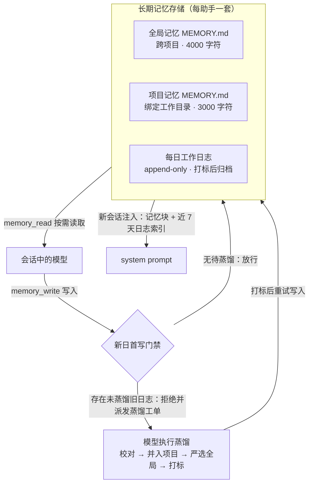
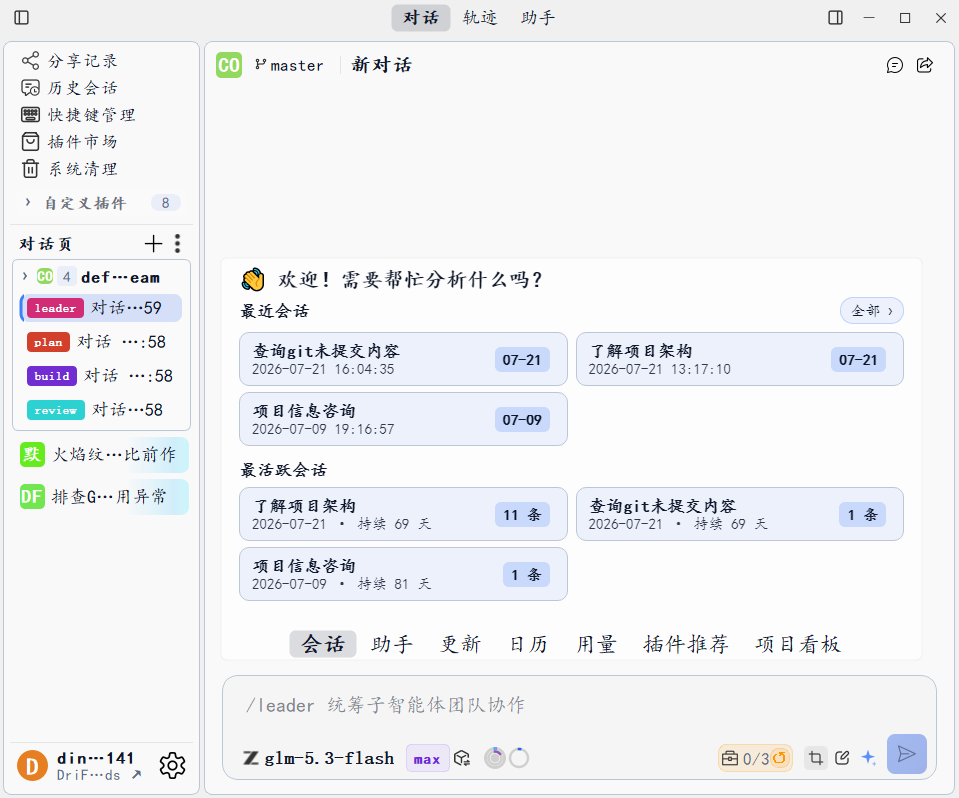
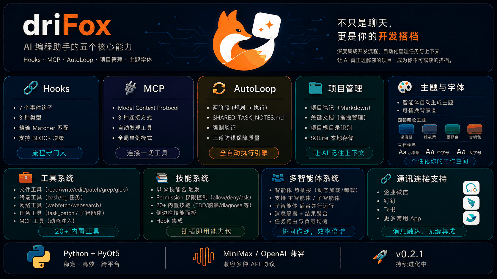
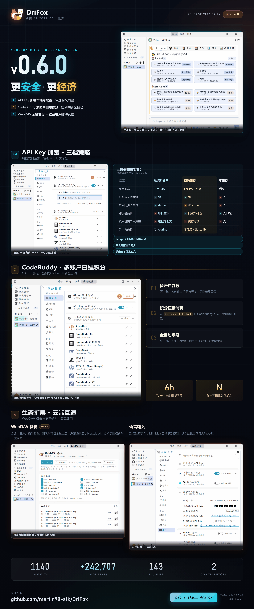
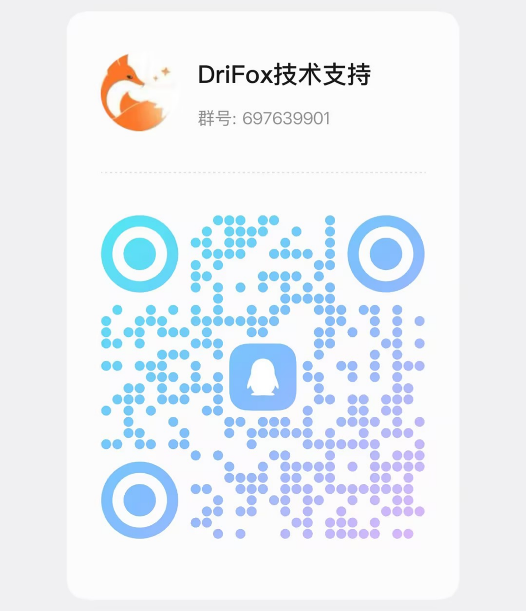

<!-- README.md -->
<p align="center">
  
</p>
<p align="center">
  
</p>

<div align="center">


</div>

<h1 align="center">DriFox 飘狐 — AI 智能体团队编排平台</h1>

<p align="center">
  <b>不是聊天框，是一间只有你一个员工的 AI 公司。</b><br>
  Leader 派单 · 多页多实例 · 多团队并存 · 跨团队协同 · 任意 OpenAI 兼容模型
</p>

---

## DriFox 是什么

DriFox 是一个桌面 AI 智能体工作台。它把「一支 AI 团队」装进了你的电脑。

在这里，软件不是传统的「单页多会话」对话列表，而是**多页多实例**：每个标签页都是一个完整的独立 Agent 窗口实例——独立会话、独立模型、独立工具权限，可以单独绑定智能体身份。一支团队，就是由这样的多个页实例搭建起来的：Leader 拆需求、按 P0/P1/P2 三级协议派单；成员在各自页实例里并行推进，通过文件邮箱回报结果；你只负责定方向、做验收。同一台机器上可以并行跑多支团队，跨团队消息带来源与去向标记，随时一键恢复任何一次团队协作的完整对话现场。

这个项目的出发点很朴素：把工程团队真实协作中那些被验证有效的实践——派单、并行、评审、交接、断点恢复——整套搬进 AI 智能体场景，而不只是做一个「能聊天的框」。

「分工」在 DriFox 里是动词：每个成员的工具权限都透明可见、实时可调。团队靠分工明细的工具权限释放不同身份智能体的能力——测试成员不该碰部署命令、探索成员拿不到写权限——而你在任何时候都能看到谁握着哪些工具、随时收紧或放开。权限调整即时生效，不重启、不重建会话。

作为工具，它是完备的：多智能体编排、工具权限实时控制、Git worktree 管理、定时任务、文件树与产物管理、多平台 IM 接入、28 个内置插件、17 套主题、MCP 协议与任意 OpenAI 兼容端点。

作为搭档，它是顺手的：工具权限随时可见、随手可调；消息卡片自带审查 / 分支 / 复制，待办与计划内嵌；长对话自动交接，换会话不断档，旧会话原始转录可随时回查。

## 功能特性

**团队编排** — 多页多实例即多成员，文件邮箱通信，Leader 按 P0/P1/P2 三级协议派单（紧急打断 / 任务变更 / 普通补充）。支持多团队并存（run_id / team_label）、跨团队邮件放行与打标、一键恢复团队 + 每个成员的历史消息。

**多智能体系统** — 9 个内置智能体：build（编码）/ plan（规划）/ explore（探索）/ review（审查）/ code-reviewer / leader（团队领导）/ task-executor / compaction / title。支持并行派发、DAG 工作流编排（失败级联跳过）、per-agent 工具白名单与模型隔离，可自定义、可插件扩展。

**工具权限实时控制** — 每个标签页实例独立的权限控制器，全部工具的开关与策略一览可见。单工具可设「直接拒绝」或「询问用户」（执行时弹确认框）两种关闭策略；任何调整即时生效，立即作用于下一次工具调用，无需重启。智能体或团队角色激活时，按其权限模板接管工具集（白名单 / deny / ask 逐条声明）——不同身份的成员岗位，获得按分工裁剪的工具能力；输入框常显危险 / 安全工具计数与当前控制方，模板接管时按钮高亮标识，一键「恢复」回用户偏好；用户手动开启的工具优先于模板，不会被静默剥夺。

**助手中心** — 多款内置人格一键切换（墨工 / 黄油 / 花子 / 阿明 / 毒蛇，或关闭人格）。每个助手拥有双层长期记忆（跨项目全局笔记 + 项目笔记 + 每日工作日志，由模型自主读写）、专属经验库（跨会话沉淀踩坑与工作习惯）和三档工具预设（全量 / 只读 / 极简）。

**上下文管理** — 8 层 tier cascade 降级链：图片剥离 → 去重 → 工具结果截断 → 超限落盘 → 参数截断 → 摘要化 → 尾保留 → LLM 压缩。阈值与开关全部可视化配置，Token 预算环形图实时反馈。

**模型接入** — 12 家内置服务商：DeepSeek / 智谱 AI / 阿里云 DashScope / 百度千帆 / 火山方舟 / MiniMax / SiliconFlow / Google Gemini / GitHub Copilot / CodeBuddy / OpenCode Zen / OpenCode Go。Copilot 与 CodeBuddy 支持 OAuth 登录；任意 OpenAI 兼容端点可加为自定义服务商；模型元数据从 models.dev 动态同步；同名模型在不同服务商下的参数完全隔离。

**MCP 系统** — 完整 Model Context Protocol 支持，含 OAuth 2.1 授权流（元数据发现 / PKCE / 动态客户端注册 / token 自动刷新），Notion 等需授权的服务一次登录即可使用；MCP 工具自动并入工具池。

**插件系统** — 28 个内置插件（18 个系统组件插件 + 10 个功能插件）。插件可贡献：工具、命令、智能体、技能、主题、Hook、MCP、模型适配器、存储引擎、网关平台、UI 组件（浮动卡片 / 内容渲染器 / 消息工厂 / 独立窗口 / 设置卡 / 侧栏入口 / 输入区按钮）。官方市场一键安装，watchfiles 热更新，即改即生效。

**安全** — API Key 三档保存：系统钥匙串（本机绑定）/ 密码加密（密文随配置云同步，换机输同一密码即可解出）/ 明文；OAuth token 走系统凭证库。安全中心提供命令解壳判定、路径白黑名单、网络外传检测、删除审批（删除类命令强制审批）、垃圾桶软删除（删除文件自动移入垃圾箱，误删可找回）、进程资源配额，全部可视化配置；企业网络的 TLS 拦截场景自动委托系统信任链校验。审批策略可配（审核处理）：人工审批（可设超时与超时处理：拒绝 / 允许 / AI 审核）或 AI 审批（由所选审核模型自动判定放行 / 拒绝，失败回落人工审批）。

**界面与交互** — 无边框窗口 + 自定义标题栏，系统托盘常驻，全局热键（`ALT+Z`，可自定义）全局唤起 / 隐藏；工作台挤压折叠（拖拽落定智能让位、压穿自动折叠、按原宽恢复、per-tab 宽度记忆）；消息卡片支持审查（diff 统计）/ 分支 / 复制 / 内嵌待办与计划卡；ECharts 交互图表、词云生成、Markdown / HTML / 图片原生渲染；17 套主题、深浅自动适配。

**会话与产物** — 历史 / 归档 / 搜索；消息级分支（从任意消息分叉新对话）；会话分享一键发布为在线 HTML 页面；工作台产物页按用户问题分组管理本会话文件；file-tree 与 Git worktree 页常驻侧栏；文件撤销。

**多平台网关** — 企业微信 / 钉钉 / Telegram / Discord / 飞书 / Slack / WhatsApp 平台框架，QQ 与微信机器人适配器见社区插件仓 [`drifox-plugins2`](https://github.com/martin98-afk/drifox-plugins2)，让 AI 团队在你常用的 IM 上随时响应。

**云同步与更新** — Gitee OAuth 账号绑定：配置、插件、密钥密文自动备份与恢复，图床上传，分享记录云端管理，token 自动续期；应用自动检查更新，支持更新代理配置。

## 与 Claude Code / DeepSeek Harness 的核心差异

> **比较时点**：2026-08-17（竞品列）；DriFox 列已更新至 v0.6.12。
> Claude Code Agent Teams 为 **research preview / experimental**（需 `CLAUDE_CODE_EXPERIMENTAL_AGENT_TEAMS=1` 启用）。
> DeepSeek Harness 为 **developer preview**（2026-08-13 发布）。

| 维度 | **DriFox** | Claude Code (Agent Teams) | DeepSeek Harness (`dsh`) |
|---|---|---|---|
| **核心定位** | 多团队并存 + Leader 派单 | 单团队多 worker + 1 orchestrator | 插件编排 + 可调用 Claude Code / Codex 作 subagent |
| **多团队并存** | ✅ **run_id / team_label**（M1，同进程跑多个团队） | ❌ 单会话单团队 | ⚠️ plugin-based，无显式多团队概念 |
| **跨团队互通** | ✅ **跨团队邮件放行 + from_run_id/to_run_id 打标** | ❌ | ❌ |
| **团队模型** | 多页多实例 + 文件邮箱（原子 JSON 写） | `.claude/teams/<id>/inbox/`（`<teammate-message>` 注入） | Cordis plugin + `@deepseek-ai/dsh-tool-subagent*` |
| **子智能体↔子智能体通信** | ✅ 邮件 peer-to-peer（leader 通过话术协议兜底） | ✅ sendMessage（agent↔agent 直发 + 广播） | ✅ continuable activation + `relay` form |
| **可继续子智能体** | ❌ 一次性（leader 可用 P0 中断重派） | ⚠️ cold resume 支持 partial | ✅ continuable activation（FIFO inbox + cold-resume） |
| **打断机制** | ✅ **协议层 P0/P1/P2**（写在 agent prompt 里） | ⚠️ 平台 API `interrupt_agent` | ✅ 平台 API `SubagentRuntime.interrupt` |
| **Agent Persona 隔离** | ✅ per-agent `prompt`/`description`/`color`/`temperature`/`model` | ✅ 子智能体独立 system prompt | ✅ `deployment.persona` 影子模板 |
| **工具隔离** | ✅ per-agent `tools` 白名单 + `PermissionResolver` | ✅ `allowedTools` in `.claude/agents/*.md` | ✅ `toolFilter`（`tools.restrict()`） |
| **工具权限实时控制** | ✅ **每标签页独立面板 + 即时生效**：逐工具开关 + deny/ask 策略，改完下一次调用即生效；智能体接管时按分工裁剪能力，用户手动调整优先于模板 | ⚠️ 改 `allowedTools` 需重启会话 | ⚠️ `toolFilter` 定义于构造期 |
| **输出结构化** | ✅ 邮件 dict 契约（`from_agent`/`to_identifier`/`status`/`result`/`run_id`） | ❌（无原生 schema） | ✅ `outputSchema` + `assertObjectJsonSchema` |
| **委派深度限制** | ❌ | ❌ | ✅ `depthLimit`（descriptor 校验） |
| **会话内容级恢复** | ✅ **一键恢复团队 + 每个成员的历史消息** | partial（session resume，不含内容恢复） | ✅ cold-resume |
| **多模型后端** | ✅ **原生 OpenAI 兼容**：DeepSeek / 智谱 / DashScope / 千帆 / 火山方舟 / MiniMax / SiliconFlow / Gemini / GitHub Copilot / CodeBuddy / OpenCode Zen / OpenCode Go 共 12 家内置 + 自定义端点 | ⚠️ 需 proxy（claude-code-proxy / claude-code-openai-wrapper / Bifrost gateway） | ✅ plugin-based，可接入任意 LLM 适配器 |
| **开源协议** | GPL-3.0-or-later | 闭源（商业） | MIT |
| **技术栈** | Python 3.14+ / PyQt5 | TypeScript / Node | TypeScript + Cordis 插件框架 |
| **开发成熟度** | v0.6.12（持续迭代） | 研究预览（v2.1.32+） | 开发者预览（2026-08-13） |

### DriFox 真正独有的四件事

1. **多团队并存（M1）**——同一进程跑产品 / 后端 / 前端 / 测试等多个团队，跨团队消息放行 + `from_run_id/to_run_id` 打标可追溯。Claude Code / Harness 都不支持。
2. **协议层 P0/P1/P2 打断**——通过 `plugins/system-agents/agents/leader.md` 的话术协议实现，不需要平台 API 改造，加 P3/P4 改一行字就全员生效。Claude Code / Harness 都用平台 API（更结构化但扩展成本高）。
3. **会话内容级恢复**——`_on_team_restore_requested` 按 run_id 查 SQLite 收集成员会话，逐 agent 建页实例并注入历史消息，恢复的不是空页而是**完整对话上下文**。
4. **工具权限实时控制**——UI 面板逐工具开关（deny / ask 双策略），改动即时作用于运行中的会话；团队分工通过角色权限模板落地，不同成员按岗位获得不同工具能力，用户手动调整始终优先于模板。

---

## 团队编排深度说明

### 团队 = 多页多实例 + 文件邮箱

```
~/.drifox6/teams/
├── default/                     ← 团队目录（每个团队一个目录）
│   ├── team.json                ← 团队元信息 + 成员列表
│   └── mailboxes/{window_id}/   ← 每个成员的消息邮箱（JSON 文件）
│       ├── {mail_id}.json
│       └── ...
├── team_product/                ← 另一团队（M1 多团队并存）
└── ...
```

- **每个标签页 = 1 个团队成员**（一个完整窗口实例、一个角色、一个 `window_id`）
- **每个成员 = 1 个独立 Agent 身份**（per-agent 工具白名单 / 提示词 / 模型）
- **邮件** = 团队目录下的 JSON 文件（原子写：tmp + `os.replace`）
- **Leader** 通过 `team_send_message(to_agent, message)` 派单，成员处理完自动通过 Stop hook 回复结果

### Leader 的三级打断协议（`plugins/system-agents/agents/leader.md`）

| 标记头 | 级别 | 适用场景 | 成员预期行为 |
|---|---|---|---|
| `【⚠️ 紧急打断 P0】` | 最高 | 用户指令变更、安全/数据风险、全局阻塞依赖 | 立即暂停当前子任务 → 优先处理 → 秒回确认 |
| `【🔁 任务变更 P1】` | 高 | 依赖变化、需求调整、上游成果修正 | 完成当前原子步骤后优先处理（不中断中途工具循环） |
| `【📝 补充 P2】` | 普通 | 进度询问、接口约定同步、非紧急澄清 | 不打断；在自然暂停点（子任务完成/回合间隙）回复 |

每条打断消息必须含六要素：**标记头 / 来源原因 / 受影响任务编号 / 具体指令 / 预期响应 / 恢复计划**。
防滥用规则：**P0 仅限三类**（用户指令变更 / 安全数据风险 / 全局阻塞依赖）；**每任务 P0 ≤1 次**；**能重派不打断**。

### 多团队并存（M1）

- **run_id** 标识一次团队运行；**team_label** 标识团队对外名
- `TeamManager.get_member_run_id(window_id)` 反查成员所属团队
- **跨团队邮件放行 + 打标**：`mail dict` 写入 `from_run_id` / `to_run_id`，历史面板可追溯
- 顶层 `team_members` 快照与 `members` 双写，恢复时优先快照

### 一键恢复团队 + 历史会话

`main_widget._on_team_restore_requested(run_id)`：

1. 查 SQLite 收集该 run_id 全部成员会话（绕开 `_history_limit=500` 截断）
2. 解散当前团队、关闭团队标签页
3. 按 `agent_name` 去重（同角色多页实例各保留一条）
4. **逐 agent 新建标签页实例 + 注入历史消息**（`history_manager.get_session_messages(session_id)`）
5. 复用当前 `run_id`（用户期望恢复后归属原团队会话）
6. Tab 分组按 run_id 同组

恢复语义：内容恢复 + 新 `session_id`（不覆盖原历史记录）。

### 派单最佳实践（来自 leader.md）

- **并行优先、流水线作业、最小化总完成时间**
- 首波无依赖任务一次性同时派出（不要分开发）
- 收到汇报即派下一波（不要"先验收再派发"两步串行）
- 探索类子任务与修改类子任务并行（若有 explore 角色）
- 失败不卡死：派给备用成员或拆分后重派

---

## 记忆系统

每个助手都有一套跨会话的长期记忆。DriFox 的路线是「模型主权」：不做后台自动编译管线，而是给模型专用的记忆读写工具与一套门禁纪律——模型自己决定记什么，系统保证记忆不会烂掉。

### 三层结构（每助手独立）

| 层 | 位置 | 上限 | 用途 |
|---|---|---|---|
| 全局记忆 | `<app_data>/assistant_hub/<助手>/MEMORY.md` | 默认 4000 字符 | 跨项目的稳定偏好与最珍贵经验，准入极严 |
| 项目记忆 | `<工作目录>/.drifox6/memory/<助手>/MEMORY.md` | 默认 3000 字符 | 当前项目的坑、决策与易错点，随目录走、随 git 管 |
| 每日工作日志 | `<工作目录>/.drifox6/memory/<助手>/YYYY-MM-DD.md` | 单条 400 字符，append-only | 实质工作的原始沉淀，蒸馏的原料 |

### 读写与注入

- 模型通过 `memory_read` / `memory_write` 两个专用工具自主维护记忆：日志追加、项目/全局笔记整体更新；写路径全部原子替换 + per-path 锁，日期参数严格校验防路径穿越。
- 每个新会话自动注入记忆块与近 7 天日志索引；记忆超限时截断并附整理指令，逼模型先整理再写入。
- 写入完成后不主动失效 system prompt 缓存：新记忆随时可读、新会话自然生效，不浪费 API 前缀缓存。

### 蒸馏门禁

记忆防腐的防线不是定时任务，而是一道「新日门禁」：新的一天首次写日志时，只要存在未蒸馏的旧日志，写入会被暂时拒绝，并返回一张完整工单——逐日读取原文 → 校对去伪 → 并入项目记忆 → 严选全局记忆 → 逐日打标。打标即重命名（`YYYY-MM-DD.md` → `YYYY-MM-DD.distilled.md`），档案保留可查、幂等可续作；全部打标完成后重试写入自动放行。超期 30 天未蒸馏的日志还会在系统提示中持续提醒。

### 配套

- **置顶记忆**：人工提示，会话启动注入，永不衰减，UI 逐条增删。
- **经验库**：从近期记忆反思提炼工作心得，超水位自动压缩合并，分类沉淀。
- **开关与上限**：助手级配置；关闭记忆后写入暂停、读取仍可用；字符上限助手级可调。
- **云同步**：助手配置与记忆纳入 Gitee 云同步，跨设备即用。

### 架构图



---

## 截图







使用中遇到问题欢迎加入技术支持群反馈：



---

## 快速开始

### 环境要求

- Python 3.14+
- PyQt5 >= 5.15.0

支持 Windows / macOS / Linux。

### 下载安装

从 [Releases](https://github.com/martin98-afk/DriFox/releases) 下载对应平台的安装包：

- **Windows**：`.exe` 安装包（Inno Setup）
- **macOS**：`.dmg`（Apple Silicon / Intel）
- **Linux**：`.AppImage`

### 源码运行

```bash
git clone https://github.com/martin98-afk/DriFox.git
cd DriFox
pip install uv
uv sync
# 可选依赖组
uv sync --group dev        # 开发工具（pytest / ruff / mypy）
uv sync --group build      # 跨平台打包（PyInstaller）
uv sync --all-groups       # 全部安装
```

```bash
python main.py
```

> 通讯平台（企业微信 / 钉钉 / Telegram / Discord / 飞书 / Slack 等）的平台适配器已迁至社区插件仓
> [`drifox-plugins2`](https://github.com/martin98-afk/drifox-plugins2)，SDK vendor 在插件 `deps/` 内，主程序不携带。

### 首次配置

启动后进入设置添加服务商：API Key 或 OAuth 登录（GitHub Copilot / CodeBuddy / Gemini Code Assist），选择默认对话模型。模型元数据启动时从 models.dev 自动同步，24 小时缓存，增量合并。

---

## 架构概要

```
┌──────────────────────────────────────────────────────────────┐
│                    DriFox v0.6.12 架构                       │
├──────────────────────────────────────────────────────────────┤
│  UI 层      标签页宿主 / 消息卡片 / 工作台 / 输入区                │
│             标题栏 + 侧栏 / 设置面板 / 浮动卡片 / 系统托盘     │
│  渲染层     Markdown→HTML / ECharts / 图片 / 代码高亮         │
│             差分渲染 / 惰性消息释放                          │
│  引擎层     对话引擎 / 工具执行 / 插件管理 / 团队系统          │
│             Agent 管理 / Hook / 上下文 Pipeline / Gateway     │
│             MCP / LSP / 定时任务 / 记忆 / 单实例控制           │
│  存储层     会话 SQLite / 记忆系统 / 日志持久化 / 配置云同步   │
└──────────────────────────────────────────────────────────────┘
```

引擎层通过插件化契约暴露扩展点：模型适配器、循环策略、存储引擎、消息序列化器、上下文分级策略（tier cascade）、网关平台、UI 组件，全部经注册表热插拔。

---

## 智能体系统

按 `mode` 声明分层（Markdown + YAML frontmatter 定义）：可作为主智能体 / 仅子智能体 / 隐藏。

| 类型 | 内置 Agent |
|------|-----------|
| **主智能体（mode: all）** | build（编码）、plan（规划）|
| **仅子智能体（mode: subagent）** | explore（探索）、leader（团队领导，P0/P1/P2 三级打断）、review / code-reviewer（审查）、task-executor（任务执行）|
| **隐藏（hidden）** | compaction（压缩）、title（标题生成）|

- **并行派发**（`subagent_para`）+ **DAG 工作流编排**（`/subagent_dag`，失败级联跳过）
- **per-agent 工具隔离**：YAML 中声明 `tools: { read: true, write: true, bash: false }`，`PermissionResolver` 按 agent 身份校验
- **per-agent Persona**：`prompt` / `description` / `color` / `temperature` / `model` 均为 agent 身份独立配置
- 插件可注册新 Agent（如助手中心的顾问人格、代码评审套件），与内置 Agent 同一机制

---

## 插件系统

```
plugins/system-*/         # 18 个系统组件插件（随应用打包）
plugins/<功能插件>/        # 10 个内置功能插件
~/.drifox6/plugins/        # 用户安装的社区插件（watchfiles 热扫描，热更新）
```

**28 个内置插件**：

| 类别 | 插件 |
|---|---|
| 系统组件（18） | agents / commands / context / hooks / hook-policies / loop-policies / mcp / model-adapters / providers / serializers / skills / storages / stream-sinks / team-templates / themes / tools / transports / cleaner |
| 功能插件（10） | assistant_hub（助手中心）· plugin-marketplace（插件市场）· worktree-manager（工作树）· file-tree（文件树）· history-manager（历史）· artifacts-manager（产物）· agent_trace（轨迹）· share-history（分享记录）· shortcut-manager（快捷键）· welcome_changelog（更新日志）|

**扩展点**：tools / commands / agents / skills / themes / hooks / mcp / gateways / model_adapters / storages / serializers / loop_policies / context_tiers / budget_resolvers / stream_sinks / transports / team_templates / ui（浮动卡片、内容渲染器、消息工厂、独立窗口、设置卡、侧栏入口、输入区按钮、右键菜单、页脚信息项）。

**17 套主题**：amber, azure, bordeaux, crema, fallout, forest, graphite, jade, laven, lumia, midnight, minta, obsidian, ocean, rosee, sakura, slate

**20 个内置技能**：brainstorming / diagnose / tdd / writing-plans / plugin-creator / ui-plugin-creator / skill-creator / drifox-dev / github-ops / find-skills / grill-me / visualization 等

**34 个内置命令**：`/team`、`/theme`、`/compact`、`/branch`、`/worktree`、`/subagents`、`/subagent_dag`、`/wordcloud`、`/webresearch`、`/release`、`/verify`、`/remember`、`/todos`、`/share`、`/title-gen`、`/lsp-install`、`/receive-review` 等

---

## 工具系统（29 个内置）

| 类别 | 工具 |
|------|------|
| **文件** | read, write, edit, multi_edit, grep, list, glob, scan_repo, stage_files |
| **终端** | bash, bg_start, bg_stop, bg_logs, bg_list |
| **交互 / 技能 / MCP** | question, skill, manage_skill, mcp_manage, upload_file |
| **子智能体 / 团队** | subagent_para, subagent_status, team_send_message, team_list_members |
| **诊断** | get_diagnostics, lsp |
| **任务** | todowrite, todoread |
| **网络** | websearch, webfetch |
| **MCP** | `mcp__server__tool`（常驻开启的 MCP Server 自动注入）；`mcp_manage`（列出全部服务器含已关闭的 / 临时开启 / 关闭临时开启）|

> 另有插件贡献的工具（助手中心记忆 / 经验库、worktree 管理等）随已装插件并入工具池。
> **websearch API key 配置**：环境变量 `TAVILY_API_KEY`（Tavily）或 `TINYFISH_API_KEY`（TinyFish，Tavily 不可用时回退）；两者均未设置时返回「搜索失败：无可用搜索引擎」。

---

## 快捷键与命令

| 快捷键 | 功能 |
|--------|------|
| `ALT+Z` | 全局热键唤起 / 隐藏主界面 |
| `/command` | 所有系统 / 插件命令统一通过 `/` 触发 |

---

## 路线图

| 阶段 | 状态 | 关键能力 |
|---|---|---|
| **v0.3.x** | ✅ 已发 | UI 插件系统（浮动卡片 / 渲染器 / 消息工厂）、团队协作、Leader、差异双栏视图 |
| **v0.4.x** | ✅ 已发 | Gitee 云同步、性能优化 |
| **v0.5.x** | ✅ 已发 | 多团队并存（M1）、跨团队邮件放行、P0/P1/P2 协议、会话内容级恢复 |
| **v0.6.x** | ✅ 已发 | 上下文 tier cascade、MCP OAuth、TLS 信任链、12 家服务商、工作台挤压折叠、消息级分支、助手中心双层记忆 |
| **v0.7** | 📋 规划 | 可继续子智能体、委派深度限制（`max_depth`）、协作 interrupt（按 P0 协议优雅退出）、SessionEvent 可重放 timeline、meta-leader 模板 |

---

## 更新日志（v0.6.x 亮点）

| 版本 | 亮点 |
|------|------|
| **v0.6.8** | TLS 信任系统（企业网自签证书链全链路修复）、MCP OAuth 2.1 登录、移除预览打字机提效 |
| **v0.6.7** | 工作台挤压折叠 + per-tab 宽度记忆、共享线程池（关窗提速）、per-model 能力 |
| **v0.6.6** | 助手中心双层记忆重做、侧边栏卡片区、工作区树 v2、移除 OpenCode 免费链路 |
| **v0.6.5** | GitHub Copilot 认证接入、系统菜单重做（一键收集环境信息提 Issue）、服务商管理重做 |
| **v0.6.4** | 服务商模型编辑器（保序去重 / 合并替换 / 批量粘贴 / 误过滤找回）、插件 sparse clone 安装 |
| **v0.6.3** | Gemini Code Assist 接入、权限审批三档作用域、上下文 tier cascade 落地 |
| **v0.6.2** | 消息级分支、消息身份系统、页脚指标（吞吐 / 速度 / 用时）、会话分享 EdgeOne 在线发布 |
| **v0.6.1** | 插件 `get_provider_config` 服务、模型参数服务商级隔离 |
| **v0.6.0** | API Key 三档加密（keyring / 密码 / 明文）、CodeBuddy 服务商、长会话内存治理 |

更早版本详见 [CHANGELOG.md](CHANGELOG.md)。

---

## 技术栈

| 技术 | 用途 |
|------|------|
| PyQt5 + PyQt-Fluent-Widgets | GUI 框架 |
| PyQtWebEngine | HTML / Markdown / ECharts / 图片渲染 |
| ECharts 5 | 交互式图表、词云 |
| SQLite | 持久化存储 |
| OpenAI Python Client | LLM API 调用 |
| MCP SDK | Model Context Protocol |
| pygls / lsprotocol | LSP 代码智能 |
| watchfiles | 插件热更新 |
| truststore | 企业网 TLS 信任链 |
| keyring | API Key 系统钥匙串存储 |
| loguru | 日志 |
| uv | 包管理 / 构建 |
| PyInstaller | 跨平台打包 |

---

## 平台支持

| 平台 | 状态 |
|------|------|
| Windows | 已支持（PyInstaller + Inno Setup 安装包）|
| macOS (Apple Silicon / Intel) | 已支持（DMG）|
| Linux | 已支持（AppImage）|

---

## 开发

```bash
uv sync --all-groups                     # 全平台依赖（Windows）
ruff check . && ruff format --check .    # 代码检查（行宽 120）
pytest tests/ -x                         # 单元测试
pytest tests/perf -v                     # 性能基准（默认不收集）
pytest tests/ui -m ui                    # 全链 UI 测试（默认不收集）
python build.py                          # 打包（Win / Linux）
```

CI：`.github/workflows/release.yml`（tag 触发三平台构建）、`.github/workflows/marketplace.yml`（插件市场自动同步）。

---

## 贡献

欢迎提交 Issue 与 PR。提交信息遵循 `feat|fix|docs|chore|refactor|test: scope - summary` 约定，详见 [CONTRIBUTING.md](CONTRIBUTING.md)。

---

## 许可证

GPL-3.0-or-later © 2025~2026 Martin98-afk

---

## Star History

<a href="https://www.star-history.com/?repos=martin98-afk%2FDriFox&type=date&legend=top-left">
 <picture>
   <source media="(prefers-color-scheme: dark)" srcset="https://api.star-history.com/chart?repos=martin98-afk/DriFox&type=date&theme=dark&legend=top-left&sealed_token=Mj0svdTPVm6s6qDntASYYQqJLSX5AfawcRyiwnc0DgeiouRtmfVM0ntXBFKOoHCj87QFuUZ68P5R5PsiJysn6K3lQpuStvpIkT09ogKvzsC_7mwNN06FPMDvipYnQ0nJQzYPh6rnlzhnDrhPVuPritcgSRsTZpfbERXnVQorhFjVfy-PUKfSwLGLaOTF" />
   <source media="(prefers-color-scheme: light)" srcset="https://api.star-history.com/chart?repos=martin98-afk/DriFox&type=date&legend=top-left&sealed_token=Mj0svdTPVm6s6qDntASYYQqJLSX5AfawcRyiwnc0DgeiouRtmfVM0ntXBFKOoHCj87QFuUZ68P5R5PsiJysn6K3lQpuStvpIkT09ogKvzsC_7mwNN06FPMDvipYnQ0nJQzYPh6rnlzhnDrhPVuPritcgSRsTZpfbERXnVQorhFjVfy-PUKfSwLGLaOTF" />
   
 </picture>
</a>

